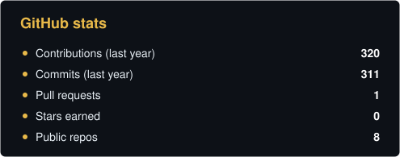
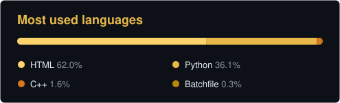
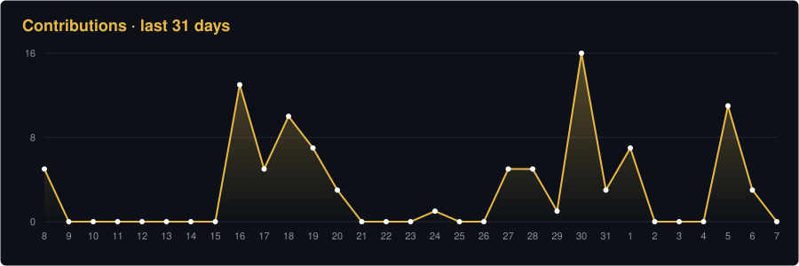

  

---

<h3 align="center">whoami</h3>

  

I make <b>websites</b>, <b>3D renders</b> and little <b>Arduino</b> things that glow. 
Most of my projects start as a <i>"what if"</i> and end up half-finished but pretty.

---

<h3 align="center">tech</h3>

  
  
  
  
  
   
  
  
  
  
   
  
  
  
  
  
  

---

<h3 align="center">statistics</h3>

  
  

  

  

<picture>
  <source media="(prefers-color-scheme: dark)" srcset="https://raw.githubusercontent.com/quexenbp/quexenbp/output/github-snake-dark.svg" />
  
</picture>

